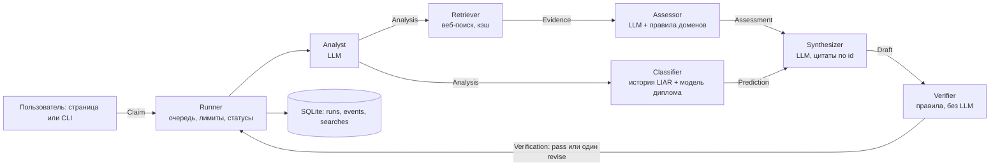

# Архитектура

Все семь ролей реализованы.
Подробный план работ лежит в `multi_agent_implementation_plan_ru.docx`.

## Почему несколько агентов, а не один

Проверка утверждения распадается на разные по природе задачи: выделить тезис, найти доказательства, получить сигнал обученной модели, оценить источники, свести вердикт и независимо его проверить.
У этих задач разные инструменты (LLM, поиск, локальная модель, правила) и разные критерии «готово».
Когда роли разделены, промежуточные результаты можно проверить по отдельности, ошибка одного шага не ломает остальное, а проверяющий без LLM не разделяет слепых пятен автора вердикта.

## Схема

Раннер (в ТЗ - оркестратор) запускает агентов по очереди и хранит состояние в SQLite.
Поиск и классификатор не зависят друг от друга и идут параллельно.

## Роли

| Роль | Что делает | Вход | Выход | Инструменты | Когда готово |
|---|---|---|---|---|---|
| Runner | Создаёт запуск, задаёт лимиты, запускает агентов, пишет конечный статус. Сам ничего не анализирует. | Claim | статусы, журнал | SQLite, журнал событий | у всех шагов есть конечный статус, итог сохранён |
| Analyst | Делает из входа один проверяемый тезис, отмечает область и язык, даёт поисковые запросы. Вердикт не выносит. | Claim | Analysis | LLM, проверка схемы | Analysis прошёл схему, тезис не пустой |
| Retriever | Ищет источники по запросам аналитика, хранит фрагменты как есть. Вердикт не выносит. | Analysis | Evidence | веб-поиск (OpenRouter или Tavily), кэш результатов | найдено не меньше двух независимых доменов, иначе `sufficient = false`; пусто - статус `insufficient_evidence` |
| Classifier | Возвращает независимый сигнал обученной модели. | Analysis | Prediction | справочник спикеров LIAR, модель диплома | шесть вероятностей валидны, версия модели записана |
| Assessor | Для каждого источника ставит релевантность, надёжность, позицию и причину. Надёжность смешивается с правилами по доменам. | Analysis, Evidence | Assessment | LLM, правила доменов | у каждого источника есть оценка |
| Synthesizer | Сводит источники и сигнал модели в вердикт со ссылками только на существующие id. | Analysis, Prediction, Evidence, Assessment | Draft | LLM, проверка цитат | все цитаты существуют, вердикт из списка |
| Verifier | Проверяет черновик правилами: цитаты, согласованность с позициями источников, границы уверенности, длину обоснования, доступность ссылок. | Draft, Evidence, Assessment | Verification | проверка цитат, правила, проверка ссылок | pass либо один круг revise |

Ни у одной роли нет больше трёх инструментов при лимите пять.
Роли не пересекаются: анализ, поиск, модель, оценка источников, сборка и проверка разделены.

## Сообщения

Все сообщения - pydantic-модели, которые сохраняются как JSON.
Общий заголовок: `schema_version`, `message_id`, `run_id`, `created_at`, `sender`, `recipient`, `in_reply_to`.
Поле `in_reply_to` связывает ответ с входящим сообщением, по нему видна цепочка.

| Сообщение | Что внутри |
|---|---|
| Claim | statement, speaker, context |
| Analysis | thesis, checkable, domain, entities, date, location, subject, speaker, context, search_queries, language, notes |
| Evidence | queries, backend, items (evidence_id, url, domain, title, published, snippet, content_hash, accessed_at), sufficient, note |
| Prediction | checkpoint_version, input_text, label, label_id, confidence, probabilities по шести классам, metadata, applicable, warnings |
| Assessment | items (evidence_id, relevance, reliability, stance, reasons), independent_domains |
| Draft | verdict, confidence, rationale, evidence_ids, conflicts, limitations, revision |
| Verification | status, checks (name, passed, detail, blocking), required_fixes |

Вердикт берётся из шести значений: true, mostly-true, half-true, mostly-false, false, unverifiable.
Фрагменты страниц считаются данными: они обрезаются до 600 символов и передаются в промпты внутри блока с пометкой «недоверенный текст».

## Состояние и журнал

Состояние лежит в SQLite (`data/app.db`).

- Таблица `runs`: вход, модель, статус, время начала и конца, результат, ошибка.
- Таблица `events`: каждое событие запуска с `agent`, `kind`, `name`, `status`, `duration_ms` и JSON-полезной нагрузкой.
- Таблица `searches`: кэш результатов поиска по запросу, он же режим офлайн-демонстрации (`SEARCH_BACKEND=cache`).

Виды событий: `run` (старт и финиш), `step` (раннер передал работу агенту), `llm_call`, `tool_call`, `message` (агент отправил сообщение).
Журнал запуска выгружается в JSONL через `GET /api/runs/{run_id}/events.jsonl`.
Ключи и секреты в журнал не пишутся.

Те же вызовы уходят в Langfuse.
Дерево повторяет запуск: корень `fact_check`, внутри наблюдения `agent` на каждого агента, генерации `analyze_claim`, `assess_sources`, `write_verdict`, `search_web` и инструменты `lookup_speaker_history`, `classify_statement`, `domain_rules`, `check_links`.
Без ключей трейсинг выключен и на работу не влияет.

## Лимиты

| Что ограничено | По умолчанию | Что происходит |
|---|---|---|
| Время запуска | 180 с | следующий вызов не делается, статус `timed_out` |
| Число шагов | 20 вызовов LLM и инструментов | статус `failed` с причиной |
| Вызов LLM | 45 с, 2 повтора | повтор только на таймаут, 429 и временные 5xx |
| Поиск | 20 с, 2 повтора (Tavily) | затем `insufficient_evidence` с причиной |
| Невалидный JSON или чужие id в ответе LLM | 1 попытка исправить | потом `failed` |
| Длина входа | 2000 символов | отклоняется до запуска агентов |
| Круг revise | не больше одного | повторный отказ проверяющего завершает запуск статусом `failed` |

Конечные статусы: `completed`, `failed`, `timed_out`, `insufficient_evidence`.
Значения меняются переменными окружения без правки кода.

## Доля вызовов по агентам

Считается по событиям `llm_call` и `tool_call` реального запуска.
Типовой запуск: аналитик 1, поиск 1, классификатор 2, оценка источников 2, сборка 1, проверка 1, всего 8, максимальная доля 25 %.
С кругом revise добавляются по одному вызову сборки и проверки, максимум остаётся 20 %.
Тест `test_full_run_all_agents_exchange_messages` проверяет, что максимальная доля не выше 0,40.
