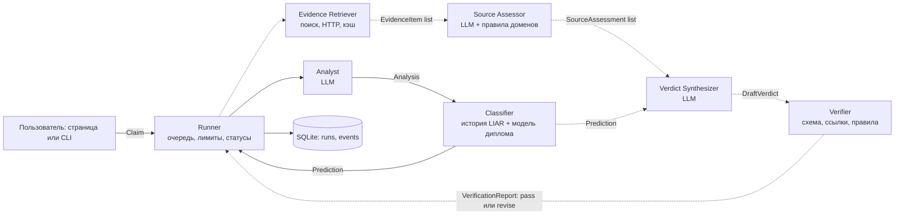

# Архитектура

Целевая система из семи ролей и то, что из неё уже сделано.
Подробный план работ лежит в `multi_agent_implementation_plan_ru.docx`.

## Почему несколько агентов, а не один

Проверка утверждения распадается на разные по природе задачи: выделить тезис, найти доказательства, получить сигнал обученной модели, оценить источники, свести вердикт и независимо его проверить.
У этих задач разные инструменты (LLM, поиск, локальная модель, правила) и разные критерии «готово».
Когда роли разделены, промежуточные результаты можно проверить по отдельности, ошибка одного шага не ломает остальное, а независимый проверяющий может вернуть черновик на доработку.

## Схема

Раннер (в ТЗ - оркестратор) запускает агентов по очереди и хранит состояние в SQLite.
Сплошные линии уже работают, пунктирные запланированы.

## Роли

| Роль | Что делает | Вход | Выход | Инструменты | Когда готово | Статус |
|---|---|---|---|---|---|---|
| Runner | Создаёт запуск, задаёт лимиты, запускает агентов, пишет конечный статус. Сам ничего не анализирует. | Claim | статусы, журнал | SQLite, журнал событий | у всех шагов есть конечный статус, итог сохранён | сделан (код, без LLM) |
| Analyst | Делает из входа один проверяемый тезис и подсказки для поиска. Вердикт не выносит. | Claim | Analysis | LLM, проверка схемы | Analysis прошёл схему, тезис не пустой | сделан |
| Classifier | Возвращает независимый сигнал обученной модели. | Analysis | Prediction | справочник спикеров LIAR (файл), модель диплома | шесть вероятностей валидны, версия модели записана | сделан |
| Evidence Retriever | Ищет материалы и вырезает нужные фрагменты, вердикт не выносит. | Analysis | список EvidenceItem | Search API, HTTP, кэш | найдены два независимых источника или статус insufficient_evidence | план |
| Source Assessor | Оценивает надёжность, свежесть, независимость и уместность каждого источника. | Analysis, EvidenceItem | SourceAssessment на каждый источник | LLM, правила доменов | у каждого источника есть объяснённые оценки | план |
| Verdict Synthesizer | Сводит доказательства и сигнал модели в черновой вердикт со ссылками. | Analysis, Prediction, SourceAssessment | DraftVerdict | LLM, сборщик цитат | все выводы привязаны к evidence_id, конфликт сигналов объяснён | план |
| Verifier | Независимо проверяет структуру, ссылки, противоречия и полноту. | DraftVerdict, снимок состояния | VerificationReport | проверка схемы, проверка URL, правила | pass либо один круг revise | план |

Ни у одной роли нет больше трёх инструментов при лимите пять.
Роли не пересекаются: анализ, поиск, модель, оценка источников, сборка и проверка - разные люди в команде.

## Сообщения

Все сообщения - pydantic-модели, которые сохраняются как JSON.
Общий заголовок: `schema_version`, `message_id`, `run_id`, `created_at`, `sender`, `recipient`, `in_reply_to`.
Поле `in_reply_to` связывает ответ с входящим сообщением, по нему видна цепочка.

| Сообщение | Что внутри | Статус |
|---|---|---|
| Claim | statement, speaker, context | сделано |
| Analysis | thesis, checkable, domain, entities, date, location, subject, speaker, context, search_queries, language, notes | сделано |
| Prediction | checkpoint_version, input_text, label, label_id, confidence, probabilities по шести классам, metadata, applicable, warnings | сделано |
| EvidenceItem | url, domain, title, date, snippet, content_hash, accessed_at | план |
| SourceAssessment | evidence_id, relevance, reliability, independence, reasons | план |
| DraftVerdict | verdict, confidence, rationale, evidence_ids, conflicts, limitations | план |
| VerificationReport | status, checks, errors, required_fixes, final_decision | план |

## Состояние и журнал

Состояние лежит в SQLite (`data/app.db`).

- Таблица `runs`: вход, модель, статус, время начала и конца, результат, ошибка.
- Таблица `events`: каждое событие запуска с `agent`, `kind`, `name`, `status`, `duration_ms` и JSON-полезной нагрузкой.

Виды событий: `run` (старт и финиш), `step` (раннер передал работу агенту), `llm_call`, `tool_call`, `message` (агент отправил сообщение).
Журнал запуска выгружается в JSONL через `GET /api/runs/{run_id}/events.jsonl`.
Ключи и секреты в журнал не пишутся.

Те же вызовы уходят в Langfuse.
Дерево повторяет запуск: корень `fact_check`, внутри `analyst` с генерацией `analyze_claim` и `classifier` с наблюдениями `lookup_speaker_history` и `classify_statement`.
Генерации создаёт интеграция `langfuse.openai`, поэтому модель, токены и стоимость пишутся сами.
Без ключей трейсинг выключен и на работу не влияет.

## Лимиты

| Что ограничено | По умолчанию | Что происходит |
|---|---|---|
| Время запуска | 120 с | следующий вызов не делается, статус `timed_out` |
| Число шагов | 8 вызовов LLM и инструментов | статус `failed` с причиной |
| Вызов LLM | 45 с, 2 повтора | повтор только на таймаут, 429 и временные 5xx |
| Невалидный JSON | 1 попытка исправить | потом `failed` |
| Длина входа | 2000 символов | отклоняется до запуска агентов |
| Круг revise (план) | не больше 1 | повторный отказ завершает запуск |

Значения меняются переменными окружения без правки кода.

## Доля вызовов по агентам

Считается по событиям `llm_call` и `tool_call` реального запуска.
В типовом запуске три вызова: один вызов LLM у аналитика и два инструмента у классификатора.
Порог 40 % из ТЗ относится к полной системе из пяти и больше агентов, там плановый максимум около 24 %.
Отчёт виден на странице и в поле `workload` ответа API.

## Что входит в первый этап

- Раннер с очередью агентов, лимитами и конечными статусами.
- Два агента с разными задачами и инструментами: LLM и локальная модель.
- Реальный обмен сообщением Analysis и ответ Prediction со ссылкой на него.
- Любая модель через OpenRouter без правки кода.
- Страница, CLI, SQLite, выгрузка журнала в JSONL, трейсинг Langfuse, тесты без сети.
